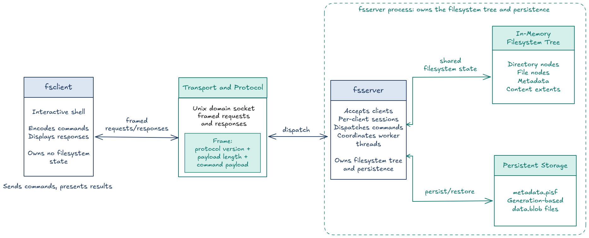

# Persistent In-Memory File System with a Custom Client Shell

**Problem statement:** SWFW_5S_05  
**Implementation:** C++17  
**Communication:** Unix domain sockets  
**Build:** GNU Make

PISF is a user-space filesystem service with two programs. `fsserver` owns the filesystem tree and persistent data. `fsclient` provides an interactive shell that sends commands to the server and displays its responses.

## Architecture



The client sends framed requests through a Unix domain socket. Each frame contains a protocol version, payload length, and command payload. The server accepts clients, gives each connection its own current working directory, dispatches commands, and synchronizes access to the shared filesystem tree.

The filesystem tree and metadata live in the server's memory. The server persists metadata in `metadata.pisf` and file contents in an append-only blob (`data.blob` or a generation-based `data-N.blob`). File nodes refer to content by byte offset and length. On startup, the server loads and validates metadata and restores the tree.

## Setup

On Ubuntu or Debian, install the compiler and build tools:

```bash
sudo apt update
sudo apt install build-essential make
```

Build the application from the repository root:

```bash
make
```

The binaries are created at:

```text
build/app/fsserver
build/app/fsclient
```

To build and run the test suite:

```bash
make test
```

## Start the server and client

In Terminal 1, start the server with a socket path and a persistent data directory:

```bash
./build/app/fsserver \
  --socket /tmp/pisf.sock \
  --data-dir "$HOME/.local/share/pisf"
```

The server creates the data directory if needed and prints its selected socket and storage paths. Leave it running.

In Terminal 2, connect the interactive client:

```bash
./build/app/fsclient --socket /tmp/pisf.sock
```

The prompt is `pisf>`. Enter commands there. For example:

```text
mkdir /projects
touch /projects/notes.txt
write /projects/notes.txt PISF keeps file content in persistent storage
ls -l /projects
read /projects/notes.txt
```

Use `quit` to end that client session. To stop the server gracefully, enter `shutdown` in the client, or press `Ctrl+C` in the server terminal.

To check persistence, restart the server with the same `--data-dir` and socket path, then run `read /projects/notes.txt` from the client.

## Commands

| Command | Purpose |
| --- | --- |
| `pwd` | Show the current session's working directory. |
| `ls [path]`, `ls -l [path]` | List directory entries, optionally with details. |
| `cd [path]` | Change the current directory; no path returns to `/`. |
| `mkdir <path>` | Create a directory. |
| `touch <path>` | Create an empty file if it does not exist. |
| `rm <path>` | Remove a file or an empty directory. |
| `rm -rf <path>` | Recursively remove a directory and its contents. |
| `create <path>` | Create an empty file. |
| `write <path> <content>` | Write content to a file. The remainder of the line is content. |
| `read <path>` | Display file content. |
| `stat <path>` | Show file or directory metadata. |
| `mv <source> <destination>` | Move or rename a file or directory. |
| `rmdir <path>` | Remove an empty directory. |
| `stats` | Show storage size, live and reclaimable bytes, generation, and file count. |
| `compact` | Compact the blob and reclaim obsolete content space. |
| `ping`, `help` | Check the server or show command help. |
| `quit` | Close the current client connection. |
| `shutdown` | Gracefully stop the server. |

Commands are case-insensitive. Relative paths are resolved using each client's own working directory. Multiple clients can connect to the same server and share the filesystem tree while keeping separate working directories.

## Persistent storage

The `--data-dir` option selects where the server stores data. If omitted, the server checks `PISF_DATA_DIR`, then `$XDG_DATA_HOME/pisf`, and finally uses `/tmp/pisf-data-<uid>`. Use the same directory every time you restart the server to restore the same filesystem.

The data directory contains:

- `metadata.pisf` — serialized filesystem tree and file metadata.
- `data.blob` or `data-N.blob` — persisted file contents.

These files are independent of `build/`. Running `make clean` removes build outputs only; it leaves the persistent data directory intact.
